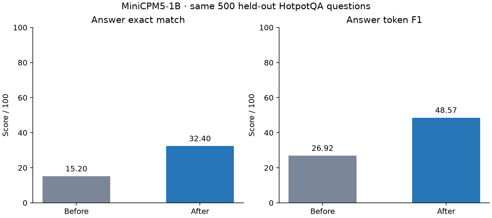

# MiniCPM5-1B: LoRA fine-tuning on 5,000 HotpotQA examples

A completed local supervised fine-tuning experiment on an Apple M5 Mac with 24 GB RAM, using MLX-LM. It adapts a pretrained 1.08B model to evidence-context QA with LoRA; it does not pretrain a new model from scratch.

**[Interactive results and all 500 before/after comparisons](https://manthan137.github.io/minicpm5-1b-hotpotqa-lora/)** · **[Full report](REPORT.md)** · **[Interview guide](training/INTERVIEW_GUIDE.md)**

| Answer metric | Before | After | Change |
| --- | ---: | ---: | ---: |
| Exact match | 15.20% (76/500) | 32.40% (162/500) | +17.20 percentage points |
| Token F1 | 26.925 / 100 | 48.567 / 100 | +21.642 points |



There were **120 newly correct answers and 34 regressions**. The gain is task-specific; 338 answers still fail exact match, and one run does not establish a performance ceiling. See the report for limitations, paired uncertainty, empty-answer failures and proposed next experiments.

## Experiment

- Model: `openbmb/MiniCPM5-1B`; data: `hotpotqa/hotpot_qa`, `distractor`.
- Exactly 5,000 training examples, sampled with seed 137.
- Same 500 saved validation question IDs before and after; sampled from 4,385 already completed baseline questions to shorten evaluation.
- Verified zero overlap in question IDs and normalized question text between training and evaluation.
- Rank 8, scale 20, 16 adapted layers, Adam, learning rate 1e-5, batch size 2, 2,500 updates, one epoch; gradient checkpointing.
- Prompt loss masking; annotated-evidence and gold-answer targets shortened to fit the output budget without changing gold answers.
- Greedy evaluation, 96 new tokens, batch size 8, official HotpotQA answer EM/F1 rules.
- No hyperparameter sweep, confidence calibration or online teacher model.

## Reproduce on Apple Silicon

Use Python 3.12. The recorded package versions are pinned in `requirements.txt`.

```sh
python3.12 -m venv .venv
source .venv/bin/activate
pip install -r requirements.txt
python training/hotpotqa_lora.py prepare
python training/hotpotqa_lora.py baseline --overwrite
python training/hotpotqa_lora.py train
python training/hotpotqa_lora.py after --overwrite
python training/hotpotqa_lora.py report
```

The saved `benchmark_selection.json` is reused by preparation. Raw data and model weights download from Hugging Face. The included prediction files define the reported run; reruns can differ with runtime, hardware, batching and upstream model revisions. Inspect `manifest.json` and saved configuration. The training package does not include the base weights, training text or adapter checkpoints.

For the recorded static results page, serve the repository root:

```sh
python3 -m http.server 8000 --bind 127.0.0.1
```

Then open `http://127.0.0.1:8000/`. The static page reads saved results; it does not run the model. The separate live dashboard needs freshly prepared benchmark data and runs with `python training/progress_dashboard.py` on port 8767.

## What is included?

- `training/`: preparation, LoRA training, evaluation, dashboard and learning material.
- `artifacts/model_training/minicpm5_1b_hotpotqa/`: manifests, fixed IDs, configuration, split audit, metrics, raw prediction files and cleaned training log.
- `results/`: all paired comparisons, a CSV score table and a static result snapshot.
- `REPORT.md`: method, findings, limitations and headroom discussion.
- `figures/`: publication figures, PNG and SVG.

The public data files reveal this benchmark's answers. Treat it as an explored benchmark for future work and reserve fresh development/final splits before further optimization.

Code: MIT. Dataset-derived comparison material: CC BY-SA 4.0. Model source: Apache-2.0. See [data attribution](DATA_NOTICE.md). Developed with AI assistance; the report documents the implemented method and measured results without claiming unsupported capabilities.
