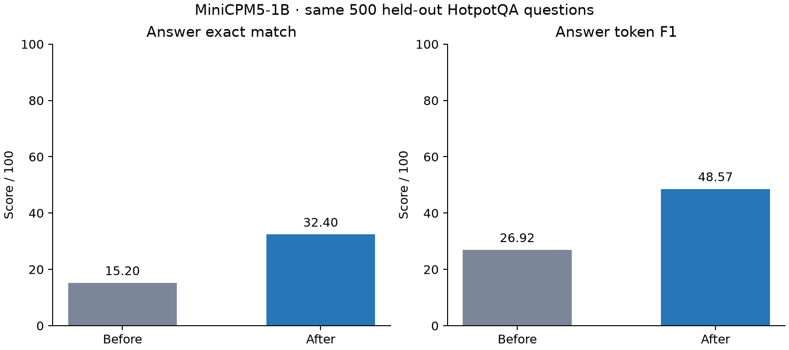

# MiniCPM5-1B training experiment

## Results

Baseline means the original model's score before this experiment's training.
Both evaluations use the identical 500 saved question IDs.

| Answer metric | Before training | After training | Change (percentage points) |
| --- | ---: | ---: | ---: |
| Exact match | 15.200% | 32.400% | +17.200 |
| Token F1 | 26.925/100 | 48.567/100 | +21.642 |

Exact match counts fully matching normalized answers. F1 measures word overlap,
giving partial credit; it is not the percentage of fully correct answers.
HotpotQA's official yes/no/noanswer scoring rules apply.
Unparsed or empty answer outputs: before 51, after 36.

## Model and data

- Model: `openbmb/MiniCPM5-1B`, 1,080,632,832 parameters, Apache-2.0.
- Source: `hotpotqa/hotpot_qa`, `distractor` configuration, English Wikipedia questions with evidence context.
- Training: exactly 5,000 examples sampled from the training split, seed 137.
- Evaluation: 500 questions randomly sampled from 4385 already completed baseline questions, seed 137.
- The original validation split has 7,405 questions. The full run was stopped at the user's request to shorten the experiment.
- Sampling used question IDs without selecting by answer correctness. IDs are in `benchmark_selection.json`.
- A 500-question sample is a limited estimate. This is not an official full-split leaderboard score or proof of broad closed-book general-knowledge improvement.

## Training method

Local MLX on the Apple Silicon machine. Supervised targets contain annotated
supporting evidence and the correct answer. Long explanations are shortened to
evidence excerpts so the complete target fits the 96-token evaluation budget;
gold answers are preserved. This is supervised correction, not an interactive
teacher that diagnoses each failure or generates hidden thinking traces.

Raw rendered prompts are encoded once and masked from training loss. A custom
loader prevents a second chat template from being applied. Training refuses to
truncate examples beyond the sequence limit.

- LoRA rank 8, scale 20.0, 16 adapted layers.
- 2500 updates × batch size 2 = 5,000 examples, one pass.
- Learning rate 1e-05; seed 137; gradient checkpointing enabled.
- Maximum sequence limit 4096; actual largest sequence 3805 tokens.
- Adapter checkpoints every 100 updates. Actual settings: `training_config.json`.

## Evaluation protocol and evidence

Same prompt, greedy decoding (temperature 0), output limit 96 tokens, and batch
size 8 before and after. Reference answers are used for scoring, never supplied
in evaluation prompts. Per-question outputs are saved in
`predictions_baseline.jsonl` and `predictions_after.jsonl`. Aggregate metrics and
question-type breakdowns are in `metrics_baseline.json`, `metrics_after.json`,
and `report.json`. The fixed benchmark is `benchmark_validation.jsonl`.
Exact training targets are in `effective_training_data.jsonl`; trained weights
are `adapters/adapters.safetensors`; runtime progress is in `training.log`.

The initial short training attempt was interrupted before restarting with
shortened evidence targets. Final training starts from the original model.
The earlier partial full-validation predictions remain archived separately.

## Reproduction and limitations

See `training/README.md` for environment variables and phase commands, and
`manifest.json` for fingerprints and the training-ID hash. Keep
`benchmark_selection.json` to reproduce the same evaluation sample.

The benchmark supplies evidence passages. It does not measure all forms of
general knowledge, reasoning, or conversational ability. Evidence selection
and joint supporting-fact metrics are not scored. Results cover one seed and
one training run. No Android/LiteRT export is validated or installed by this
experiment. No model or adapter is uploaded.

Dataset: CC BY-SA 4.0; model: Apache-2.0. Attribution and any applicable
ShareAlike requirements should be reviewed before redistribution.

## Sources

- [Model](https://huggingface.co/openbmb/MiniCPM5-1B)
- [Dataset](https://huggingface.co/datasets/hotpotqa/hotpot_qa)
- [Official scoring](https://github.com/hotpotqa/hotpot/blob/master/hotpot_evaluate_v1.py)
- [MLX training](https://github.com/ml-explore/mlx-lm/blob/main/mlx_lm/LORA.md)

## Interpretation and remaining headroom

The experiment demonstrates a task-specific gain, not a measurement of general intelligence or a demonstrated model ceiling. Exact-match answers rose from **76/500 to 162/500**, a gain of **17.2 percentage points**. That is about 2.13 times the original exact-match count, but **338/500 responses still fail exact match**. Some semantic answers may be penalized by strict string matching; F1 gives partial overlap credit.

| Paired outcome | Questions |
| --- | ---: |
| Correct in both runs | 42 |
| Wrong before, correct after | 120 |
| Correct before, wrong after | 34 |
| Wrong in both runs | 304 |

The 120 gains and 34 regressions show that adaptation does not help every example. Bridge questions gained 19.51 EM points; comparison questions gained 7.37 points. These are descriptive breakdowns, not separate tuning targets or causal explanations.

Empty parsed answers increased from **1 to 18**. The broader missing-marker-or-empty flag decreased from 51 to 36, so these two diagnostics should not be conflated. Inspect the verbatim responses in the UI: some explanations consume the output budget before a complete final answer appears. Output length, target format and actual reasoning failures need controlled diagnosis; the current run cannot attribute the gain or remaining errors to any one factor.

### Is 32.4% the model's limit?

We do not know. One epoch, one seed and one hyperparameter configuration do not estimate an architecture's ultimate ceiling. There is no learning-curve sweep or controlled comparison against full fine-tuning, alternative datasets, or larger models. Lower training loss proves a better fit to the teaching targets, not further held-out improvement. More data, epochs or adapter capacity could help, plateau, overfit, or regress.

The initial 15.2% is performance under this specific prompt, evidence context, output budget and strict scorer. HotpotQA asks for evidence use across multiple Wikipedia passages, with distractors. It is not an IQ test or a broad general-knowledge score. See the [HotpotQA paper](https://arxiv.org/abs/1809.09600).

### How much confidence should we place in the measured gain?

A paired bootstrap resampling these 500 questions 5,000 times gives an approximate 95% interval of **12.60 to 21.80 percentage points** for EM change and **17.03 to 26.26 points** for F1 change. This describes question-sampling variability on this explored sample. It does not account for training-seed variation, sample-selection bias, public pretraining contamination, or generalization to other tasks. It is not evidence that the model is ready for broad deployment.

### Proposed next experiments — not performed in this run

1. Create a separate development set outside the 5,000 training examples and this explored benchmark. Reserve a fresh final evaluation set before choosing further settings.
2. Diagnose format and truncation on development data: compare output budgets and concise answer-first versus evidence-first targets. If prompts or decoding change, compare base and tuned models under the same new protocol; keep this report's original results intact.
3. Audit a structured sample of factual, evidence-selection, comparison and formatting errors. Improve teaching-target quality based on development and training data.
4. Measure development learning curves at fractions of an epoch and across additional epochs. Stop when development quality stops improving; low training loss alone is not the selection rule.
5. Run a small, recorded learning-rate/rank/layer sweep and repeat promising settings across seeds. Increase data quantity only with quality and leakage checks.
6. If needed, compare a larger base model under matched prompts, data and scoring. This distinguishes adaptation effects from model-size effects without assuming either will solve the task.

After displaying the 500 questions and their outputs, treat them as an **explored benchmark**. Do not repeatedly optimize against their answers and continue calling them an untouched final exam. No additional training has been started by this discussion.

## Data-split verification

The actual training-ID hash matches the preparation manifest. Prepared and effective training prompts match. The 5,000 training examples and 500 benchmark questions have **zero overlapping IDs and zero overlapping normalized question texts**. This does not rule out shared facts/passages or the original model's pretraining exposure. See `dataset_split_audit.json`.

## Figures and publication contents

Published materials include source code, the fixed benchmark IDs, configuration, aggregate and paired metrics, a score table, the interview guide, and verbatim before/after comparisons. The local base-model cache, 5,000 training texts, intermediate checkpoints and final adapter weights are not included in this repository. The code can train another adapter locally. The static results page does not run inference.

The 500-question comparison collection includes HotpotQA excerpts and model-generated outputs. Dataset-derived material is attributed in `DATA_NOTICE.md` and supplied under CC BY-SA 4.0; code is licensed separately. Generated responses may contain errors and do not represent verified supporting evidence.

## Actual training data and measured task categories

The selected 5,000 training examples contain **3,966 bridge questions and 1,034 comparison questions**. Difficulty labels are 1,010 easy, 3,127 medium and 863 hard. Training targets combine supporting evidence and the gold answer; the full input includes the supplied context passages. The following are real training examples, not held-out evaluation examples:

- **bridge / medium**: Human Error" is the season finale of the third season of a tv show that aired on what network? **Gold answer:** Fox.
- **comparison / medium**: Which tennis player won more Grand Slam titles, Henri Leconte or Jonathan Stark? **Gold answer:** Jonathan Stark.
- **bridge / easy**: Which faith is designated to the University of Providence, private university accredited by the NW association of Schools and Colleges and located in a third largest city in Montana after being passed by Missoula?  **Gold answer:** Roman Catholic.

Some shortened teaching excerpts omit useful comparison details. This is a target-quality limitation to investigate rather than evidence that further learning is impossible. The exact targets for these examples are included in `training_data_summary.json` and shown on the public page.

| Question type | Evaluation questions | Before EM | After EM | EM change | Before F1 | After F1 |
| --- | ---: | ---: | ---: | ---: | ---: | ---: |
| Bridge | 405 | 14.32% | 33.83% | +19.51 points | 26.34 | 50.59 |
| Comparison | 95 | 18.95% | 26.32% | +7.37 points | 29.43 | 39.92 |

Bridge questions connect facts across passages; comparison questions compare entities or quantities. These are task categories. No separate subject-domain evaluation establishes improvement in medicine, coding, mathematics or other specialties.
